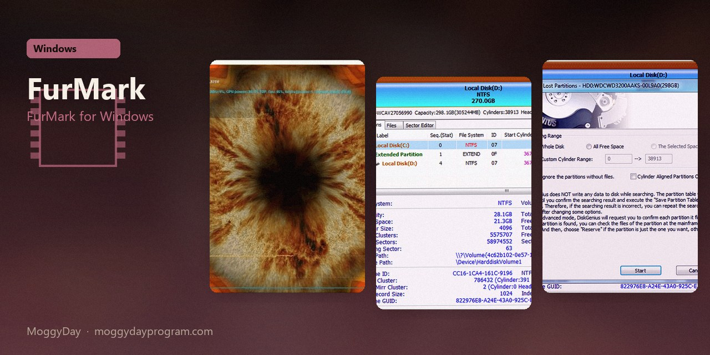
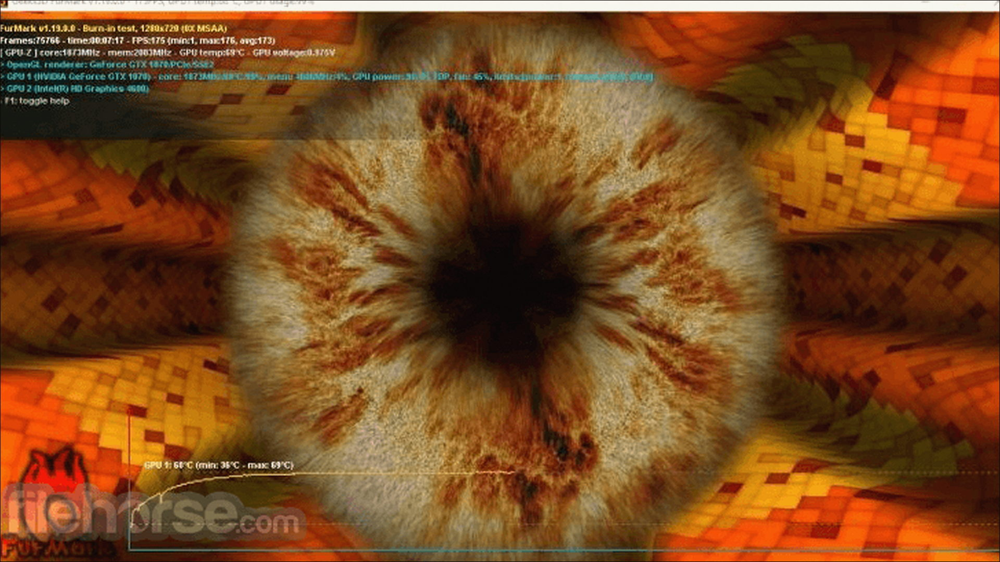
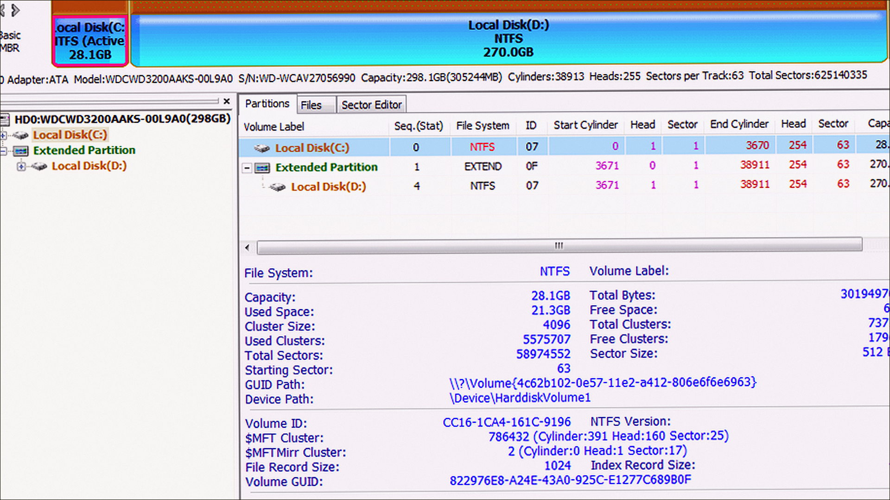
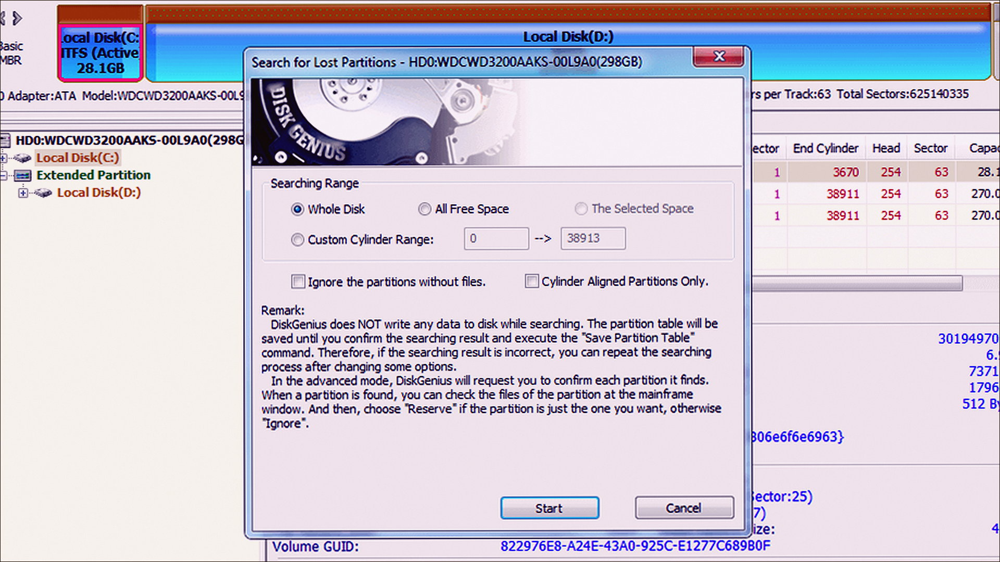

# FurMark 2.10.2

FurMark for Windows. FurMark on Windows 10/11 x64. 32 MB. Requirements, screenshots, MoggyDay Launcher.

[Pages](https://laserbetweenmap.github.io/furmark-windows/) · [RU](https://moggydayprogram.com/programs/furmark) · [EN](https://moggydayprogram.com/en/programs/furmark)

  

  
  
  

1. Open the RU or EN card on moggydayprogram.com
2. Press **Download** on that card. The file is only on moggydayprogram.com — not in this repo.

Category: [System catalog](https://moggydayprogram.com/categories/system)

- [GPU-Z](https://moggydayprogram.com/programs/gpu-z)

No installer in this git repo.
